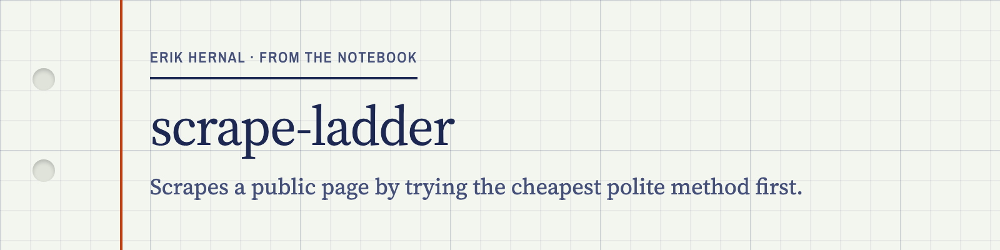

<picture>
  <source media="(prefers-color-scheme: dark)" srcset=".github/banner-dark.png">
  
</picture>

# scrape-ladder

A small FastAPI service that scrapes a public page by trying the cheapest polite method first, then tells you which one worked. More on [erikhernal.com](https://erikhernal.com/built/?utm_source=github).

## The problem

The private scraper this came from had a block check that read pages for wall words. On 2026-11-20 it labeled two block pages as fine: one site's own wall and a security plugin's wall. Neither page used the words the check looked for.

So in this build a status code never decides success. Every answer has to pass a quality check, and a challenge page or login wall counts as a failure even when it comes back as HTTP 200. So does a page with almost no text on it.

## What it does

`POST /scrape-url` climbs this ladder and stops at the first rung whose answer passes the quality check:

1. **Official source.** If the request names an `export_url` (CSV, JSON or XLSX), take it.
2. **Plain HTTP fetch** with `httpx` and an honest user agent. The internal-address guard refuses private, loopback, link-local and cloud metadata addresses. It checks again after every redirect and after DNS, then connects to the address it checked.
3. **Structured parse** for CSV, JSON and XLSX.
4. **Page metadata**: JSON-LD, OpenGraph and microdata, read with `extruct`.
5. **Selectors** for stable fields, from the request's `selectors` map (`selectolax`).
6. **Main text** with `trafilatura`.
7. **Headless browser** (Playwright, Chromium) for pages that build their content with JavaScript. It's optional, and without it the rung says `skipped: browser not installed`. Every request the browser makes goes through the same guard.
8. **Paid fetch**: a stub that always says `disabled: paid fetches are off in this build`. No setting turns it on.

Along the way it respects robots.txt and waits a second between requests to the same host (both on by default). Every page also goes through the block check.

The response tells you:

- `rung`: which rung answered, or `null` when none did.
- `ladder`: all eight rungs with a `status` (`answered`, `done`, `skipped`, `failed`, `refused`, `disabled` or `not_reached`) and a plain `reason`.
- `quality`: `passed` plus the reasons it failed.
- `block`: what the block check made of the page.
- `text`, `fields`, `metadata`, `structured`: what the rungs pulled out.
- `telemetry`: timings, fetches, bytes and polite wait for this request only. Nothing is kept after it.

## What's left out, on purpose

This build doesn't try to get past bot walls: no patched or stealth browsers, no browser impersonation, no captcha handling and no hosted fetch services. When the ladder meets a wall it reports it and stops.

Also left out: every client target list and policy, the job queue, page watching, cost tracking and search. The paid rung is a stub that names no vendor.

<!-- 30-second demo GIF goes here. `vhs demo.tape` makes it. -->

## Run it yourself

With Docker:

```bash
docker compose up --build -d
curl -s -X POST localhost:8080/scrape-url -H 'content-type: application/json' \
  -d '{"url":"http://fixture.test/article.html"}'
docker compose down
```

The curl asks for `http://fixture.test/article.html`. Compose serves `fixtures/site/` under that name on its own network, so it all works offline. That network is private, so `docker-compose.yml` names `fixture.test` as the one trusted host the guard lets through.

Without Docker:

```bash
python3.12 -m venv .venv && .venv/bin/pip install -e ".[dev]"
.venv/bin/python scripts/demo_offline.py
curl -s -X POST localhost:8080/scrape-url -H 'content-type: application/json' \
  -d '{"url":"http://fixture.test:8081/article.html"}'
```

The sample site in `fixtures/site/` is made up: an article, a product page with JSON-LD, CSV and JSON exports, a page that only renders with JavaScript, a fake challenge page, a thin page and a path robots.txt disallows.

Tests: `.venv/bin/pytest` runs 129 tests with no outside network. Two of them drive a real headless browser and need `pip install -e ".[browser]"` and `playwright install chromium`. Without those, pytest skips that file and reports 127 passed. CI installs both.

Settings are environment variables, all optional:

| Variable | Default | What it does |
|---|---|---|
| `SCRAPE_LADDER_POLITE_DELAY_S` | `1.0` | Seconds between requests to one host |
| `SCRAPE_LADDER_TRUSTED_HOSTS` | empty | Exact host names the internal-address guard lets through |
| `SCRAPE_LADDER_BROWSER` | `auto` | `off` never uses the browser rung |
| `SCRAPE_LADDER_USER_AGENT` | `scrape-ladder/0.1 (...)` | The user agent sent with every request |
| `SCRAPE_LADDER_TIMEOUT_S` | `15` | Request timeout |
| `SCRAPE_LADDER_MIN_TEXT_CHARS` | `200` | Main text shorter than this fails quality |

## One real result

The offline demo, one curl for the article, run on 2026-11-25:

```text
1 official_source   skipped      no export_url in the request
2 http_fetch        done         200 text/html, 2824 bytes
3 structured_parse  skipped      the response is text/html, not CSV, JSON or XLSX
4 page_metadata     skipped      no typed JSON-LD or microdata item on the page (OpenGraph tags kept)
5 selectors         skipped      no selectors in the request
6 main_text         answered     1815 characters of main text
7 headless_browser  not_reached  answered at main_text
8 paid_fetch        disabled     paid fetches are off in this build
```

The same run is a test: `tests/test_demo.py` line 33 checks that the article answers at `main_text`, and the lines after it check each skip reason.

## Where it came from

Pulled out of a private repo on 2026-11-25. The history stays private because it holds client data. The sample data is made up.

## Contact

erik@erikhernal.com. License: MIT.
